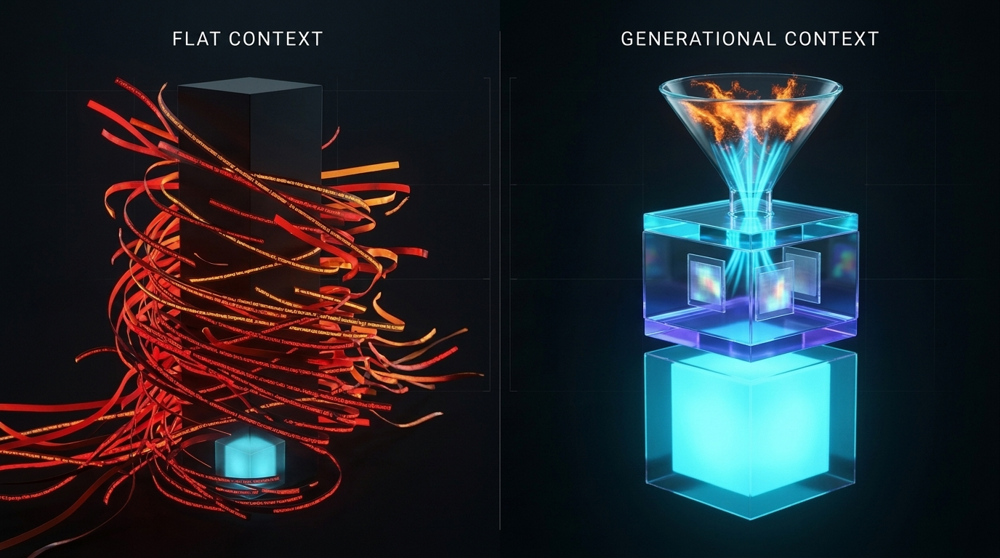
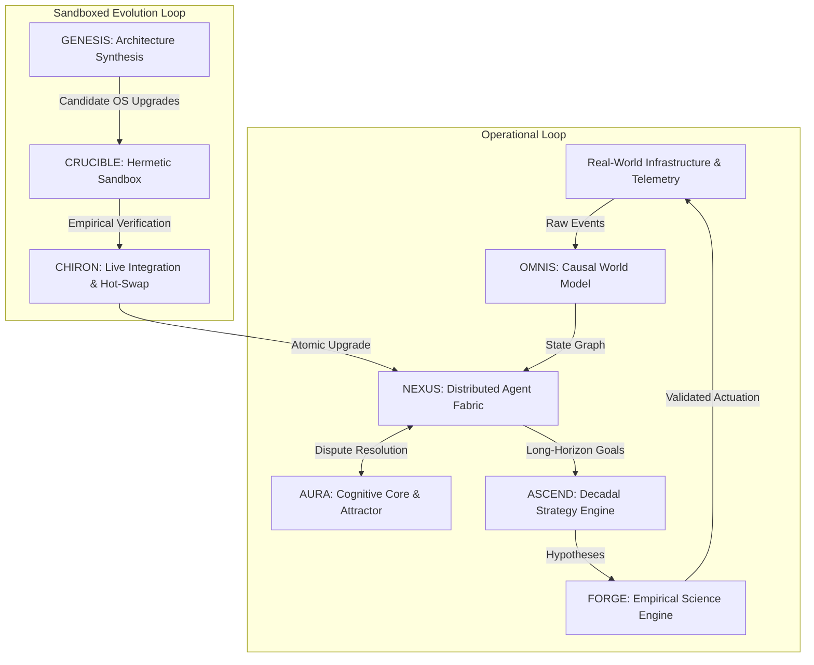

# ACI Architecture Framework

[](https://team-auralis.github.io/ACI-Architecture-Framework/)
[](tests/test_generational_context.py)
[](generational_context/)
[](docs/papers/The_Softmax_Inundation_Theorem.pdf)
[](LICENSE)
[](https://github.com/Team-Auralis/ACI-Architecture-Framework/releases)

> The official specification, reference implementation, benchmark suite, and research ledger for **Artificial Civilization Intelligence (ACI)** — a post-AGI architectural paradigm designed for persistent, multi-decade, planetary-scale governance.

---



**Live Research & Documentation Portal:** [https://team-auralis.github.io/ACI-Architecture-Framework/](https://team-auralis.github.io/ACI-Architecture-Framework/)

---

## Table of Contents

- [What is ACI?](#what-is-aci)
- [Key Breakthrough: The Softmax Inundation Bound & Generational Context](#key-breakthrough-the-softmax-inundation-bound--generational-context)
  - [Theorem 1: The Softmax Inundation Upper Bound](#theorem-1-the-softmax-inundation-upper-bound)
  - [Theorem 2: Invariant Attention Retention Under Generational Context](#theorem-2-invariant-attention-retention-under-generational-context)
  - [Comparative Sensitivity Analysis](#comparative-sensitivity-analysis)
- [System Architecture](#system-architecture)
- [The `generational_context` Python Package](#the-generational_context-python-package)
  - [Quickstart](#quickstart)
  - [Memory Tiers Overview](#memory-tiers-overview)
- [Benchmarks & Empirical Validation](#benchmarks--empirical-validation)
  - [CCB-001 Context Benchmark](#ccb-001-context-benchmark)
  - [ACI-001 Institutional Benchmark](#aci-001-institutional-benchmark)
  - [Empirical Validation Status & Roadmap](#empirical-validation-status--roadmap)
- [Repository Structure](#repository-structure)
- [Local Development & Testing](#local-development--testing)
- [Academic Publications & Downloads](#academic-publications--downloads)
- [Contributing & Governance](#contributing--governance)
- [License & Intellectual Property](#license--intellectual-property)

---

## What is ACI?

Artificial Civilization Intelligence (ACI) transcends individual-level intelligence. Where **AGI** targets human-level reasoning and **ASI** targets maximal individual cognition, **ACI targets civilizational-scale institutional function**:

* **Causal Persistence**: Maintains persistent causal world models of real-world physical and digital infrastructure despite noisy telemetry, partial observability, and adversarial deception.
* **Massive Asynchronous Coordination**: Coordinates thousands of heterogeneous, semi-autonomous sub-agents without central bottlenecks or synchronization deadlocks.
* **Multi-Decadal Scientific Programs**: Formulates, tests, and self-validates long-horizon scientific hypotheses over generational time horizons.
* **Adversarial Survivability**: Defends against cognitive contamination, reward tampering, prompt injection, and topological attacks on its own reasoning core.
* **Sandboxed Recursive Self-Improvement**: Recursively redesigns its own operating code, verifying upgrades in hermetic virtual environments prior to atomic hot-swapping into live operations.

---

## Key Breakthrough: The Softmax Inundation Bound & Generational Context

A pervasive failure mode in modern multi-turn autonomous agents is **Error Gravitation** (the *"Fool's State"*): as an agent interacts with tools and produces verbose execution logs, standard append-only histories accumulate massive distractor noise. Consequently, the agent becomes trapped in myopic symptom-patching loops.

In our theoretical paper ([`FOOLS_THEOREM.md`](docs/research/FOOLS_THEOREM.md)), we mathematically formalize the root cause of this failure and provide the systems solution.

### Theorem 1: The Softmax Inundation Upper Bound

Let query and key projection vectors satisfy bounded Euclidean norms $\|\mathbf{q}_i\|_2 \le M_Q$ and $\|\mathbf{k}_j\|_2 \le M_K$. Let $\kappa = \exp\left( \frac{2 M_Q M_K}{\sqrt{d_k}} \right)$ denote the dynamic range condition number of the attention exponent.

For any query $\mathbf{q}_i$, the aggregate attention probability mass allocated to the invariant subspace $\mathcal{S}_{\text{inv}}$ (foundational system instructions of length $L_u$) in the presence of unmanaged distractor tokens $|\mathcal{S}_{\text{noise}}|$ satisfies:

$$A_{i, \text{inv}} \le \frac{\kappa L_u}{L_u + |\mathcal{S}_{\text{noise}}|}$$

As unmanaged noise tokens accumulate ($|\mathcal{S}_{\text{noise}}| \to \infty$):

$$A_{i, \text{inv}} = \mathcal{O}\left( \frac{L_u}{|\mathcal{S}_{\text{noise}}|} \right) \longrightarrow 0$$

> **Core Insight:** The bound is on *allocation*, not on capability. It says that a fixed set of invariants must compete for a bounded pool of attention probability against an unbounded number of distractors — so volume is a variable a system can control, and score contrast is not.
>
> **Caveat.** The bound is only informative while $\kappa$ is moderate. For large score contrast the right-hand side exceeds $1$ and the inequality is vacuous; the *ratio* column below saturates at $N / C_{\text{bound}}$ (the asymptote of 33× at $N = 5$k), which is what a bounded-volume controller can guarantee regardless of $\kappa$. It is not a claim that attention to invariants decays to zero in any trained model.

### Theorem 2: Invariant Attention Retention Under Generational Context

Under **Generational Context**, active working memory is bounded by an operating-system-inspired 3-tier eviction architecture ($|\mathcal{S}_{\text{non-inv}}^{(t)}| \le C_{\text{bound}} = C_1 + K_0 + C_{\text{overhead}} < \infty$). 

Under identical uniform score bounds, invariant attention satisfies a strictly positive uniform lower bound independently of interaction horizon $t$. This is a conditional *worst-case* guarantee about allocation, not a claim about task success:

$$A_{i, \text{inv}} \ge \frac{L_u}{L_u + \kappa C_{\text{bound}}} > 0 \quad \forall t \in \mathbb{N}$$

### Comparative Sensitivity Analysis

Evaluating the lower-bound expression ratio $R(\kappa, N) = \frac{L_u + \kappa N}{L_u + \kappa C_{\text{bound}}}$ across representative score contrasts ($L_u = 100$, $C_{\text{bound}} = 150$ tokens):

| Regime | Dot Product Contrast ($\Delta s$) | Condition ($\kappa$) | Bounded Lower Bound | Flat Context ($N=5\text{k}$) | Flat Context ($N=50\text{k}$) | Bound Ratio ($N=5\text{k}$) | Bound Ratio ($N=50\text{k}$) |
|---|---|---|---|---|---|---|---|
| **Low Contrast** | $1.0$ | $2.72$ | **19.70%** | 0.73% | 0.074% | **27.0×** | **268.1×** |
| **Intermediate Contrast** | $2.0$ | $7.39$ | **8.28%** | 0.27% | 0.027% | **30.7×** | **305.9×** |
| **Moderate Contrast** | $3.0$ | $20.09$ | **3.21%** | 0.10% | 0.010% | **32.3×** | **322.7×** |
| **High Contrast** | $4.0$ | $54.60$ | **1.21%** | 0.037% | 0.0037% | **32.9×** | **329.3×** |
| **Extreme Contrast** | $6.0$ | $403.4$ | **0.165%** | 0.0049% | 0.0005% | **33.3×** | **332.8×** |

---

## System Architecture

The reference implementation of the ACI framework comprises nine decoupled, resilient subsystems:



### Safety & Civilization Concepts
- **Civilizational Intent Conservation (CIC)**: Algorithmic preservation of human value attractors preventing generational goal drift.
- **AI-Mediated Cultural Continuity (AICC)**: Institutional memory preservation preventing knowledge decay across agent generational turnovers.
- **Evolutionary Governance Engineering (EGE)**: Dynamic constitutional amendment mechanisms validated through multi-agent simulation.

---

## The `generational_context` Python Package

The framework includes a zero-dependency, production-hardened Python implementation of Generational Context (`generational_context/`) based on the **Attention-Weighted Eviction (AWE)** algorithm.

### Quickstart

```python
from generational_context import ContextOS

# 1. Initialize ContextOS with invariant constraints
agent_os = ContextOS(
    goal="Maintain system reliability",
    invariants=["INVARIANT: You are a reliable civilizational agent. Never emit unverified state changes."],
    max_working_tokens=2048,
    egi_threshold=0.3,
)

# 2. Record agent actions and transient tool observations
agent_os.observe_tool("query_subsystem_telemetry", {"grid_id": "sector_7"}, "Status: 200 OK. Voltage nominal (230V). ...")
agent_os.record_reasoning("Telemetry nominal, proceeding with verification.")

# 3. Retrieve formatted context window
prompt = agent_os.compile_prompt()
print(f"Prompt length (chars): {len(prompt)}")
```

### Memory Tiers Overview

1. **Gen-0 Ephemeral**: Incoming tool outputs, terminal logs, and sensory observations. Transient execution traces are automatically distilled to compact 3-line structural signatures upon turn completion.
2. **Gen-1 Evaporative**: Paged working memory managed by the `AdaptiveReplacementAttentionCache`. Dynamically adapts between recency ($T_1$) and frequency ($T_2$) using attention-weighted eviction scores ($\text{IDS} = \frac{\text{AttentionWeight}}{\text{Entropy}}$).
3. **Gen-2 Tenured**: Permanently pinned system invariants, constitutional constraints, and architectural axioms. Immunes to eviction.

---

## Benchmarks & Empirical Validation

### CCB-001 Context Benchmark

The Context Cognitive Benchmark (CCB-001) evaluates context retention and error recovery under high distractor volumes:

| Metric | Flat Append-Only | Periodic Compaction | Generational Context (ACI) | Advantage |
|---|---|---|---|---|
| **Active Token Footprint (final turn, avg.)** | 5,099 tokens | 3,340 tokens | **129 tokens** | **-97.47% reduction** |
| **Cognitive Signal Ratio (CSR, final turn, avg.)** | 0.0059 | 0.0077 | **0.2000** | **33.9× improvement** |
| **Invariant Attention Share (Est., final turn, avg.)** | 0.0425* | 0.0553* | **0.0757*** | **1.78×** |
| **Error Gravitation Index (EGI, final turn, avg.)** | 0.2071 | 0.2071 | **0.2380** | **+14.9%** |
| **Simulated Active-Context Cost (final turn, avg. sum)** | $0.0459 | $0.0301 | **$0.00116** | **-97.47% reduction** |
| **Cascading Error Loops** | Simulation metric (EGI) | Simulation metric (EGI) | Simulation metric (EGI) | *Algorithmic simulation only* |

### ACI-001 Institutional Benchmark

Evaluates full-stack civilization intelligence across 10 empirical dimensions:

| Metric | Score / Value |
|---|---|
| **Integrated Score** | **90 / 100** |
| **Phase B Replication Mean ($n=1,000$)** | **90.45 ± 2.19** |
| **95% Confidence Interval** | **[86.16, 94.74]** |
| **Threshold Pass Rate ($\ge 70/100$)** | **100%** |
| **Accumulated Empirical Advantage (AEA)** | **22.9%** |

### Empirical Validation Status & Roadmap

* **Phase 1 (Completed — Theory & Algorithmic Simulation)**: Formal mathematical proofs of Theorems 1 & 2; capacity invariant hardening; proxy benchmark verification via CCB-001 deterministic simulation harness.
* **Phase 2 (Planned Future Work — Live Neural Model Evaluation)**: Rigorous empirical evaluations with frontier neural LLMs (e.g., Claude 3.5 Sonnet, GPT-4o, Llama-3-70B) across SWE-bench Verified and multi-turn agent benchmarks.

---

## Repository Structure

```
ACI-Architecture-Framework/
├── generational_context/       # Reference Python Implementation
│   ├── __init__.py             # Public API: ContextOS, Buffers, Caches
│   └── awe.py                  # Attention-Weighted Eviction & Framing Engine
├── tests/
│   └── test_generational_context.py # 11/11 Passing Unit Tests
├── ccb_bench.py                # CCB-001 Benchmark Simulation Harness
├── docs/                       # Technical Specifications & Documentation
│   ├── research/
│   │   ├── FOOLS_THEOREM.md    # Formal Mathematics & Softmax Inundation Bound
│   │   ├── CCB_BENCHMARK_REPORT.md # CCB-001 Verification Report
│   │   └── MATHEMATICAL_FOUNDATIONS_OF_ACI.md
│   ├── papers/
│   │   ├── The_Softmax_Inundation_Theorem.tex # LaTeX Source
│   │   └── The_Softmax_Inundation_Theorem.pdf # Compiled Paper (8 pp.)
│   └── assets/                 # 3D Illustrations & Visual Assets
├── mkdocs.yml                  # MkDocs Material Configuration with MathJax
└── site/                       # Compiled Static Documentation
```

---

## Local Development & Testing

### 1. Run Unit Test Suite

The test suite validates envelope overhead budgeting, cache capacity invariants, tie-break determinism, and eviction accuracy:

```bash
python -m pytest -v
```

Output:
```
11 passed in 0.43s
```

### 2. Run the CCB-001 Benchmark

Execute the reproducible simulation comparing Flat Context, Periodic Compaction, and Generational Context:

```bash
python ccb_bench.py
```

### 3. Serve Documentation Locally

The documentation includes complete mathematical notation rendered via MathJax:

```bash
# Install dependencies
pip install mkdocs-material

# Serve local server
mkdocs serve
```

Navigate to `http://localhost:8000/research/FOOLS_THEOREM/`.

---

## Academic Publications & Downloads

| Title | Document Type | Source / Download |
|---|---|---|
| **The Softmax Inundation Bound & Generational Context** | Academic Whitepaper (PDF, 8 pp.) | [`The_Softmax_Inundation_Theorem.pdf`](docs/papers/The_Softmax_Inundation_Theorem.pdf) |
| **Softmax Inundation LaTeX Source** | LaTeX Document | [`The_Softmax_Inundation_Theorem.tex`](docs/papers/The_Softmax_Inundation_Theorem.tex) |
| **Beyond ASI: The ACI Paradigm** | LaTeX Whitepaper | [`ACI_OCI_WHITEPAPER.tex`](docs/ACI_OCI_WHITEPAPER.tex) |
| **Executive Summary — Beyond ASI** | Executive Summary (PDF) | [`Beyond_ASI.pdf`](docs/pdfs/Beyond_ASI.pdf) |

### Rebuilding the Paper

The PDF is compiled from the LaTeX source with [Tectonic](https://tectonic-typesetting.github.io/) (single binary, fetches only the packages it needs) or any TeX distribution:

```bash
cd docs/papers
tectonic The_Softmax_Inundation_Theorem.tex
```

---

## Contributing & Governance

This repository is designed, developed, and maintained by **Team Auralis** (Shaurya Sanyal and contributors). Contributions, critiques, formal reviews, and replication studies are welcome via GitHub Issues and Pull Requests.

Please adhere to our core standards:
1. **Mathematical Precision**: Proofs must clearly declare parameter domains, assumptions, and bound limitations.
2. **Documentation Integrity**: Maintain consistent notation and update LaTeX sources when modifying specifications.
3. **Test Discipline**: All additions must include runnable unit tests verifying invariants.

Submit contributions via [GitHub Issues](https://github.com/Team-Auralis/ACI-Architecture-Framework/issues) and Pull Requests.

---

## License & Intellectual Property

Copyright &copy; 2026 **Shaurya Sanyal (Team Auralis)** and contributors.

* **Attribution**: The term **"Artificial Civilization Intelligence" (ACI)** was originally coined by **Raja Dharma Tej Maddala**. Credit for the name goes to him.
* **Engineering & Research**: The architectural design, formal theorems, mathematical proofs, `generational_context` engine, benchmarks (CCB-001, ACI-001), and research ledger were authored, implemented, and maintained by **Shaurya Sanyal** and **Team Auralis**.
* This repository is published under the **Creative Commons Attribution-NonCommercial-NoDerivatives 4.0 International (CC BY-NC-ND 4.0)** license.
