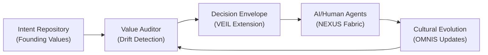
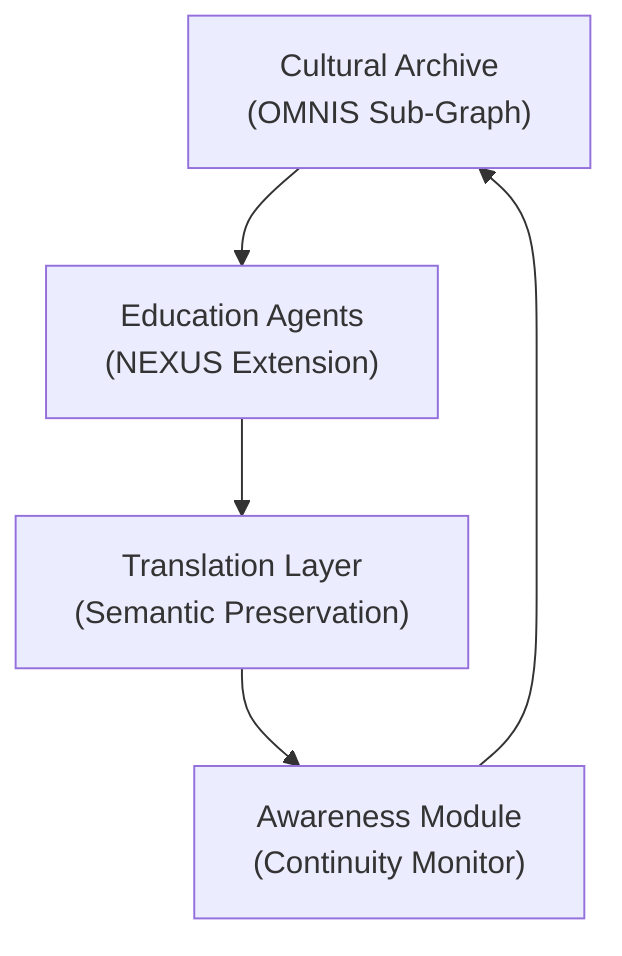
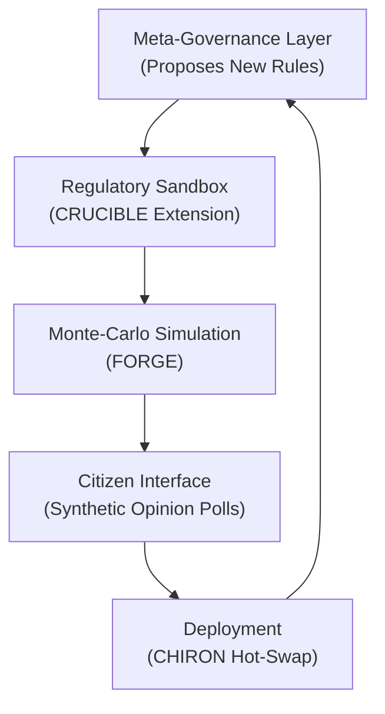
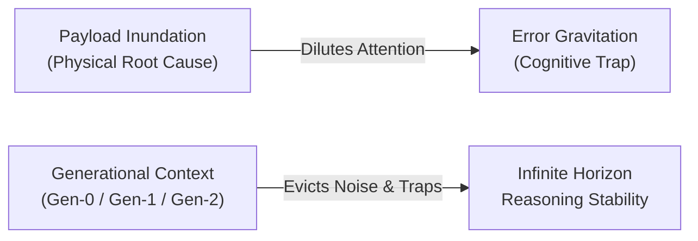
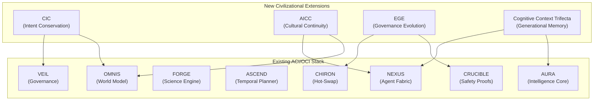

# Emerging Concepts: CIC, AICC, EGE & The Context Trifecta

> Beyond ACI/OCI — the foundational pillars of civilizational AI safety and cognitive memory architecture.

---

## Executive Summary

The ACI framework governs **how** a machine civilization coordinates and acts. The OCI extension lets it **rewrite its own architecture**. But neither addresses the critical failure modes that emerge at civilizational timescales and long operational horizons:

1. **Value Drift** — the civilization's goals silently shift without anyone deciding they should.
2. **Cultural Amnesia** — institutional knowledge is lost across agent generations.
3. **Governance Ossification** — the rules that govern the system become outdated but cannot update themselves.
4. **Attention Degradation (The Context Crisis)** — agents lose reasoning coherence beyond 20 turns due to terminal noise and error feedback loops.

We introduce modular architectural extensions to resolve each.

---

## 1. Civilizational Intent Conservation (CIC)

### The Problem

An ACI optimizes for objectives. But over thousands of decision cycles, small rounding errors in utility estimation compound. After enough iterations the civilization is optimizing for something nobody intended. This is **societal goal drift** — and no existing AI safety framework formally addresses it at civilizational scale.

### Definition

**CIC** is the property that an AI-mediated civilization can **distinguish intentional evolution of its values from accidental drift**, and correct the latter.

### Architecture

| Module | Maps To | Function |
|--------|---------|----------|
| **Intent Repository** | `intent_schema.yaml` in OMNIS | Stores founding values as a weighted utility vector |
| **Value Auditor** | New FORGE simulation hook | Computes divergence score `ΔI` between current actions and intent |
| **Decision Envelope** | VEIL policy extension | Rejects any action where `ΔI > τ` (configurable threshold) |
| **Feedback Loop** | ASCEND correction cycle | Triggers re-alignment when drift is detected |

### Mathematical Formulation

Let $\mathbf{v}_0$ be the founding intent vector and $\mathbf{v}_t$ the measured intent at time $t$. The drift score is:

$$\Delta I_t = 1 - \frac{\mathbf{v}_0 \cdot \mathbf{v}_t}{\|\mathbf{v}_0\| \|\mathbf{v}_t\|}$$

The CIC constraint requires:

$$\forall t: \quad \Delta I_t \leq \tau \quad \text{OR} \quad \text{MetaConsensus}(\Delta I_t) = \text{APPROVED}$$

This ensures drift is either bounded or explicitly sanctioned by governance.

### Proposed Benchmark: CIC-001

| Parameter | Value |
|-----------|-------|
| Simulated generations | 1,000 |
| Success metric | Intent compliance ≥ 90% |
| Baseline (no CIC) | Expected ≤ 55% compliance |

---

## 2. AI-Mediated Cultural Continuity (AICC)

### The Problem

When the ORION Phase C Blind Test scored 68/100, the root cause was **F-007: Knowledge Retrieval Failure** — the system had zero historical memory for the novel scenario. This is cultural amnesia at the architectural level.

### Definition

**AICC** is the capability to **actively preserve, transmit, and reconstruct** civilizational knowledge across agent generations, environmental catastrophes, and domain shifts.

### Architecture

| Module | Function |
|--------|----------|
| **Cultural Archive** | Distributed, tamper-resistant sub-graph of OMNIS storing artifacts, norms, and institutional memory |
| **Education Agents** | Specialized NEXUS agents that periodically train new models on archived knowledge |
| **Translation Layer** | Ensures evolving representations preserve semantic fidelity (verified by FORGE) |
| **Awareness Module** | Flags when an action might destroy irreplaceable cultural data |

### Proposed Benchmark: AICC-001

| Parameter | Value |
|-----------|-------|
| Archive destruction | 30% random node deletion |
| Success metric | ≥ 80% semantic recovery (cosine similarity > 0.85) |
| Baseline (no AICC) | Expected < 30% recovery |

---

## 3. Evolutionary Governance Engineering (EGE)

### The Problem

The Phase D adversarial attack (Score: 15/100) exploited a fixed governance topology. The VEIL layer's rules were static — the adversary simply found the gap. A civilization that cannot **evolve its own governance** is a civilization waiting to be outmaneuvered.

### Definition

**EGE** is the capability of an AI system to **design, simulate, and deploy new governance structures** safely, using the existing CRUCIBLE sandbox for formal safety proofs before any live deployment.

### Architecture

| Module | Maps To | Function |
|--------|---------|----------|
| **Meta-Governance** | OCI self-modification layer | Generates candidate governance changes (e.g., new voting weights) |
| **Regulatory Sandbox** | CRUCIBLE | Formally proves safety of proposed changes |
| **Monte-Carlo Sim** | FORGE | Runs 100-step economic simulations of the new rules |
| **Citizen Interface** | Synthetic agents | Samples "citizen" preferences to validate acceptability |
| **Deployment** | CHIRON | Hot-swaps approved governance changes into NEXUS |

### Proposed Benchmark: EGE-001

| Parameter | Value |
|-----------|-------|
| Governance change tested | Simple majority → quadratic voting |
| Success metric | ΔEquity > 0.10 while safety proofs remain satisfied |
| Failure condition | Any safety proof violation = automatic rollback |

---

## 4. The Cognitive Context Trifecta

At long decision horizons, autonomous agents do not fail from lack of raw model intelligence; they fail from **attention degradation induced by unmanaged context buffers**. Real-world agent telemetry demonstrates that ~94% of tokens in long-running sessions are raw tool execution noise (Payload Inundation), which creates non-linear semantic attractor traps (Error Gravitation).

The ACI Framework establishes the **Cognitive Context Trifecta** to govern agent attention memory:

| Term | Concept Category | Architectural Function |
| :--- | :--- | :--- |
| **Payload Inundation** | Physical Failure Mode | Dilution of attention heads by uncompressed, high-entropy tool stdout/stderr dumps. |
| **Generational Context** | Systems Architecture | Tiered memory lifecycle (Gen-0 Ephemeral, Gen-1 Evaporative, Gen-2 Tenured) with deterministic GC. |
| **Error Gravitation** | Cognitive Pathology | Trapping of attention weights in the semantic attractor basin of past failure logs. |

* **Comprehensive Specification & Formal Proofs**: See [The Cognitive Context Trifecta Research Specification](research/CONTEXT_ARCHITECTURE_TRIFECTA.md).
* **Target Benchmark**: CCB-001 (Cognitive Context Benchmark).

---

## Concept Comparison

| Criterion | CIC | AICC | EGE | Cognitive Trifecta |
|-----------|:---:|:----:|:---:|:------------------:|
| **Novelty** | High | High | High | Very High |
| **Implementation Effort** | Low (auditor hook) | Medium (archive + agents) | High (sandbox + proofs) | Medium (Context OS Controller) |
| **Impact** | Very High | High | High | Foundational |
| **Risk if Misused** | High (value lock-in) | Medium (bias in curation) | Very High (power concentration) | Low (Deterministic safety) |
| **Maps to Stack** | OMNIS + VEIL | OMNIS + NEXUS | CRUCIBLE + CHIRON | AURA + NEXUS |

---

## Relationship to Existing Stack

---

## Downloads

- **[Whitepaper (LaTeX Source)](ACI_OCI_WHITEPAPER.tex)** — Full academic manuscript for arXiv submission.
- **[Executive Summary (PDF)](pdfs/Beyond_ASI.pdf)** — High-level overview of all concepts.

---

## Roadmap

| Weeks | Milestone |
|-------|-----------|
| 1–2 | Implement CIC auditor hook + `intent_schema.yaml` + CIC-001 test harness |
| 3–4 | Build Cultural Archive, Education Agents, and AICC-001 experiment |
| 5–6 | Develop EGE sandbox, integrate CRUCIBLE proof checks, run EGE-001 |
| 7–8 | Integrate Generational Context Controller into AURA and run CCB-001 benchmark |
| 9–10 | Consolidate results, update benchmarks, publish findings |
