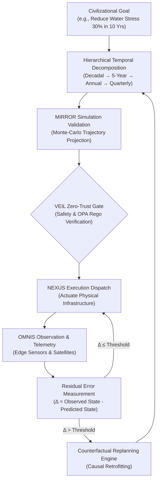

# ASCEND: Long-Horizon Temporal Planning Engine

> **Authored by Shaurya Sanyal (Mr Fool) — Team Auralis, 2026**  
> *Definitive Engineering & Algorithmic Specification for Decadal Multi-Agent Planning.*

---

## 1. Executive Summary

In classical AI agents, "planning" is conflated with generating a sequence of text steps in an LLM prompt. This fails over long horizons: text plans cannot handle stochastic drift, non-Markovian dynamics, environmental catastrophes, or shifting resource boundaries.

**ASCEND** (Autonomous Strategic Coordination & Decadal Execution Network Dispatcher) is ORION's **temporal planning and trajectory correction engine**. It handles planning across four distinct temporal scales:
- **Decadal (10–50 Years)**: Civilizational objective envelopes and structural carrying capacity.
- **Strategic (3–5 Years)**: Infrastructure buildouts, scientific research roadmaps, and economic resilience goals.
- **Tactical (Annual / Quarterly)**: Resource allocations, inter-agency milestones, and capacity expansion.
- **Operational (Daily / Real-Time)**: Execution dispatch to NEXUS agent workflows and physical actuations via VEIL.

---

## 2. Mathematical Formulation: Hierarchical Macro-POMDPs

ASCEND models long-horizon civilizational trajectory tracking as a **Hierarchical Partially Observable Markov Decision Process (Macro-POMDP)**:

$$\mathcal{M}_{\text{ASCEND}} = \langle \mathcal{S}, \mathcal{A}_{\text{macro}}, \mathcal{T}, \mathcal{R}, \Omega, \mathcal{O}, \gamma, \mathcal{H} \rangle$$

Where:
- $\mathcal{S}$: Continuous civilizational state space represented in the OMNIS Causal World Model.
- $\mathcal{A}_{\text{macro}}$: Hierarchical macro-actions (e.g., "Transition regional power grid to 80% nuclear/renewables").
- $\mathcal{T}(s' \mid s, a_{\text{macro}})$: Long-horizon state transition kernel, simulated and stress-tested in the MIRROR digital twin.
- $\mathcal{R}(s, a_{\text{macro}})$: Multi-objective civilizational reward function bounded by the Civilizational Intent Conservation ($I_t$) core.
- $\Omega, \mathcal{O}$: Observation space and observation probability from edge telemetry and satellites.
- $\gamma \in (0, 1]$: Intertemporal discounting factor calibrated with **quasi-hyperbolic discounting** ($\beta$-$\delta$ model) to prevent short-termist collapse while maintaining mathematical convergence.
- $\mathcal{H}$: Temporal horizon ($\mathcal{H} \in [10^2, 10^5]$ hours / $10^1$ to $5 \times 10^1$ years).

---

## 3. Core Architecture: Memory-as-Plans & World-Action Modeling (MaP-WAM)

### 3.1 The Continuous Replanning Loop
ASCEND never operates as an open-loop executor. It executes a closed cybernetic control loop:

$$\text{OBSERVE} \longrightarrow \text{MEASURE RESIDUAL } (\Delta) \longrightarrow \text{UPDATE SCM} \longrightarrow \text{COUNTERFACTUAL REPLAN} \longrightarrow \text{DISPATCH}$$

1. **Residual Error Vector ($\Delta_t$)**:
   $$\Delta_t = \| S_t^{\text{observed}} - S_t^{\text{projected}} \|_{\Sigma^{-1}}$$
   Where $\Sigma^{-1}$ is the covariance matrix of OMNIS state uncertainty.
2. **Selective Replanning Boundary**:
   - If $\Delta_t < \epsilon_{\text{operational}}$: Local operational adjustment by NEXUS domain agents.
   - If $\epsilon_{\text{operational}} \le \Delta_t < \epsilon_{\text{strategic}}$: Annual milestone reallocation and resource re-budgeting.
   - If $\Delta_t \ge \epsilon_{\text{strategic}}$: Macro-replanning triggered; full trajectory re-simulated in MIRROR across 20-year lookaheads with human-in-the-loop escalation.

---

## 4. Constraint Enforcement & Intertemporal Invariants

ASCEND enforces hard mathematical boundaries across all temporal scales:

| Category | Invariant Rule | Enforcement Mechanism |
| :--- | :--- | :--- |
| **Thermodynamic Limit** | Total planetary / regional energy draw $\le$ grid thermal threshold | Hard clamp in VEIL OPA policy |
| **Resource Depletion** | Critical reserve aquifer / mineral drawdown rate $\le$ replenishment rate | Stochastic depletion bound |
| **Civilizational Intent (CIC)** | Operational trajectory must not drift from founding intent ($\Delta I_t \le \tau$) | Merkle DAG provenance validation |
| **Reversibility Principle** | High-impact actions must preserve a bounded rollback path | Rollback checkpoint stored in OMNIS |

---

## 5. Failure Recovery & Trajectory Convergence

If an external catastrophic shock occurs (e.g., pandemic, seismic disaster, critical grid collapse):
1. **ASCEND Emergency Partition**: Freezes active decadal expansions and prioritizes baseline life-support invariants.
2. **Causal SCM Intervention**: Isolates compromised infrastructure nodes in the OMNIS graph using Pearl's $do$-calculus:
   $$P\big(\text{Recovery} \mid do(\text{Isolate Node } X)\big)$$
3. **Regenerative Horizon Reseed**: Re-computes shortest viable path to baseline stability, restoring the multi-year trajectory without human panic or central bottleneck deadlock.
