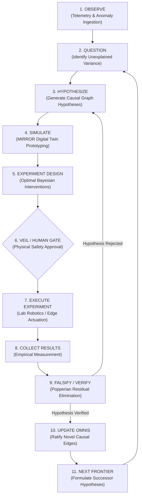

# FORGE: The Scientific Discovery & Hypothesis Engine

> **Authored by Shaurya Sanyal (Mr Fool) — Team Auralis, 2026**  
> *Definitive Engineering & Epistemic Specification for Autonomous Scientific Discovery.*

---

## 1. Executive Summary

True civilizational intelligence cannot merely extrapolate patterns from historical datasets. When novel crises emerge (e.g., unexpected pathogens, materials degradation under space radiation, or unprecedented climate feedback loops), the system must be capable of generating **novel scientific knowledge**.

**FORGE** is the **automated scientific hypothesis and causal discovery engine** of the ACI architecture. It operates an automated Popperian falsification loop: formulating causal hypotheses, designing discriminative experiments, validating them in the MIRROR digital twin simulation, and updating the global OMNIS causal world model with cryptographic provenance.

---

## 2. The 11-Stage Scientific Discovery Loop

---

## 3. Algorithmic Foundation: Active Causal Discovery

FORGE combines observational constraint search with continuous interventional optimization to discover true causal DAGs:

### 3.1 Constraint-Based Discovery (PC / FCI)
- Tests conditional independence relations $X \perp\!\!\!\perp Y \mid \mathbf{Z}$ across telemetry streams using kernel-based conditional independence tests.
- Reconstructs the **Markov Equivalence Class** (CPDAG) of the underlying physical system.

### 3.2 Continuous Optimization (NOTEARS / DCDI)
To resolve directionality among observationally equivalent graphs, FORGE solves a continuous constrained optimization problem:

$$\min_{W \in \mathbb{R}^{d \times d}} \mathcal{L}(W) \quad \text{subject to} \quad h(W) = \text{tr}\left(e^{W \odot W}\right) - d = 0$$

Where $h(W) = 0$ is the exact algebraic characterization of acyclicity (DAG constraint), enabling efficient gradient-based discovery of complex planetary-scale networks.

---

## 4. Bayesian Experimental Design & Discriminative Testing

When multiple competing hypotheses explain the observed data ($H_1, H_2, \dots, H_k$), FORGE does not guess. It computes the **Expected Information Gain (EIG)** to design an experiment $\xi^*$ that maximizes mutual information between the outcome $Y$ and the true hypothesis $H$:

$$\xi^* = \arg\max_{\xi} \mathbb{E}_{Y \mid \xi} \left[ D_{\text{KL}}\Big(P(H \mid Y, \xi) \parallel P(H)\Big) \right]$$

### 4.1 The Role of the MIRROR Digital Twin
- Before any physical experiment or real-world intervention is dispatched, it is run across $10^4$ stochastic rollouts inside the **MIRROR** simulation environment.
- If an experiment has non-zero probability of exceeding safety boundaries (e.g., thermal runaway, chemical contamination), it is rejected immediately by VEIL.

---

## 5. Epistemic Provenance & Integrity Standards

In accordance with the ACI Research Integrity Protocol:
1. **Zero Hallucination Tolerance**: Every proposed causal relationship $A \to B$ in OMNIS must link to an immutable Merkle cryptographic proof containing:
   - The originating observational sensor log;
   - The mathematical test statistic ($\text{p-value} < 10^{-6}$ or Bayes Factor $\ge 100$);
   - The digital signature of the human/laboratory executor that verified the experiment.
2. **Anti-Dogmatism Check**: Periodically re-tests historical causal axioms against recent observational residuals to prevent **Institutional Epistemic Lock-in**.
