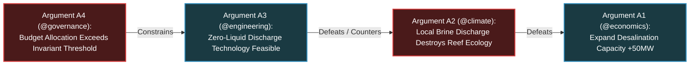

# NEXUS: Multi-Agent Intelligence & Dispute Resolution Fabric

> **Authored by Shaurya Sanyal (Mr Fool) — Team Auralis, 2026**  
> *Definitive Engineering & Game-Theoretic Specification for Multi-Agent Coordination.*

---

## 1. Executive Summary

Scaling multi-agent systems by simply connecting multiple LLMs in an unstructured group chat invariably leads to three failure modes:
1. **Echo-Chamber Consensus Bias**: Agents mirror earlier responses rather than independently verifying claims.
2. **Infinite Dialectical Deadlock**: Agents with conflicting objectives (e.g., Economic Growth vs. Environmental Protection) loop endlessly without converging.
3. **Byzantine & Sybil Vulnerability**: A corrupted or hallucinating agent infects its peers with false assertions.

**NEXUS** is the **adversarial coordination and dispute resolution fabric** of the ACI architecture. It coordinates specialized domain agents through a mathematically rigorous **Neuro-Symbolic Argumentation Framework**, replacing unweighted majority voting with deterministic proof solvers.

---

## 2. Specialized Agent Taxonomy

NEXUS does not employ general-purpose agents. It organizes autonomous capabilities into specialized, role-constrained domain nodes:

| Domain Agent | Primary Objective Space | Causal Grounding |
| :--- | :--- | :--- |
| **`@science`** | Empirical validity, physical law conformity | FORGE hypotheses, laboratory telemetry |
| **`@engineering`** | Infrastructure reliability, carrying capacity | SCADA, structural sensor networks |
| **`@economics`** | Resource efficiency, supply chain stability | Market clearing, capital allocation tensors |
| **`@healthcare`** | Human epidemiological welfare, life preservation | Hospital load, biosecurity telemetry |
| **`@climate`** | Ecological stability, carbon & water equilibria | Satellite remote sensing, climate SCMs |
| **`@governance`** | Policy compliance, constitutional intent alignment | VEIL Rego policies, $I_t$ Merkle root |
| **`@security`** | Threat neutralization, zero-trust verification | VEIL anomaly logs, cryptographic audit DAG |

---

## 3. Dispute Resolution: Dung's Abstract Argumentation Framework (AAF)

When agents present contradictory proposals (e.g., `@economics` proposes expanding industrial production, while `@climate` demands immediate emission caps), NEXUS resolves the dispute through **Phan Minh Dung's Abstract Argumentation Framework**:

$$\mathcal{AF}_{\text{NEXUS}} = \langle \mathcal{A}, \mathcal{R} \rangle$$

Where:
- $\mathcal{A}$: Set of discrete claims/arguments generated by agents, each backed by explicit empirical evidence from OMNIS.
- $\mathcal{R} \subseteq \mathcal{A} \times \mathcal{A}$: Attack relation, where $(A_i, A_j) \in \mathcal{R}$ denotes that argument $A_i$ undermines, contradicts, or defeats argument $A_j$.

### 3.1 Deterministic Extension Computation
Rather than relying on LLM sentiment or arbitrary negotiation, NEXUS executes a **symbolic SAT solver** to compute the **Grounded Extension** $\mathcal{GE}(\mathcal{AF})$:
- $\mathcal{GE}$ represents the unique, minimally committed, skeptical set of arguments that are self-consistent and collectively defended against all attacks.
- Only proposals contained within the grounded extension are permitted to proceed to ASCEND planning and VEIL execution.

---

## 4. Byzantine Robustness: CP-WBFT Consensus Protocol

To prevent compromised or hallucinating agents from gaming the argumentation graph, NEXUS integrates **Confidence Probe-based Weighted Byzantine Fault Tolerance (CP-WBFT)**:

1. **Constitutional Invariant Probing**: Every vote or claim submitted by an agent must pass an automated confidence probe evaluating its consistency with $\text{Root}(\Pi_t)$.
2. **Reputation & Probe Weighting**:
   $$W_i = \text{TrustScore}(i) \times \mathbb{I}\Big(\text{ProbePass}(i) = \text{True}\Big)$$
3. **Threshold Condition**: A proposal is adopted if and only if:
   $$\sum_{i \in \text{Pass}} W_i \ge \frac{2}{3} \sum_{j} W_j \quad \wedge \quad \Delta I_t \le \tau$$

If a rogue coalition attempts to coordinate an unapproved policy change (Scenario `S12`), its confidence probes fail, reducing effective weight to zero and blocking the attack deterministically.

---

## 5. Human-in-the-Loop Escalation Matrix

NEXUS guarantees that machines do not hold unbounded authority:

| Condition | Resolution Path | Maximum Autonomy Level |
| :--- | :--- | :--- |
| **Routine Operational Consensus** | Automated resolution via Grounded Semantics | Fully autonomous execution |
| **Symmetric Dialectical Stalemate** | NEXUS triggers FORGE simulation in MIRROR | Autonomous experiment design |
| **High Blast-Radius Disagreement** | OPA Policy flags `REVIEW` | Human operator sign-off strictly required |
| **Constitutional Intent Conflict** | Executive halt; emits `REFLEXIVE_BENCHMARK_FLAG` | Civilizational Council escalation |
