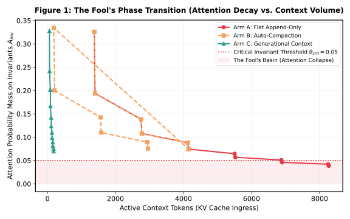
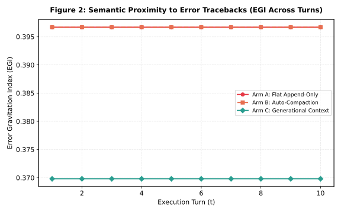
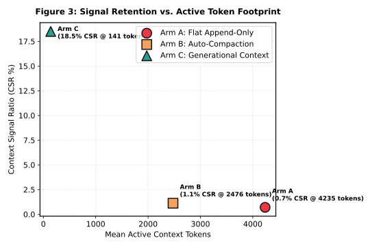

# CCB-001: Context Compaction & Heuristic Attention Simulation Report

> **Deterministic Algorithmic Simulation of Softmax Dilution and Token Economics**  
> *Generated: 2026-10-24 06:45:14 UTC*  
> *Data Source: [`ccb_results.csv`](file:///E:/ACI-Architecture-Framework/ccb_results.csv)*

> [!IMPORTANT] Methodological Scope Notice: Algorithmic Simulation vs. Real Transformer Inference
> 1. **Algorithmic Simulation**: This benchmark measures token economics and heuristic attention dilution in a deterministic environment using 128-dimensional subword hash embeddings and scaled dot-product softmax. These metrics serve as an algorithmic surrogate to analyze token allocation mechanics under controlled conditions; they do NOT measure neural activations from real LLM transformer weights.
> 2. **Real-LLM Evaluations (Planned Work)**: Empirical evaluations on live frontier models (e.g., Claude 3.5 Sonnet, GPT-4o, Llama 3) across multi-turn software engineering benchmarks (e.g., SWE-bench, InterCode) are **currently planned future work** and have not yet been conducted. No empirical claims regarding live LLM reasoning accuracy or task success rates are made or implied by this simulation.
> 3. **Attention Distribution vs. Task Success**: Attention metrics evaluate the mathematical allocation of probability mass across context tokens. Theorem 1 establishes attention mass dilution, not inevitable cognitive reasoning failure in every model architecture. Theorem 2 establishes a lower bound on invariant attention mass under uniform bounded energy, not guaranteed agent task success.

---

## 1. Executive Summary & Comparative Matrix

The CCB-001 simulation evaluates memory footprint, signal retention, and attention dilution across three architectures:
1. **Arm A (Flat Append-Only)**: Appending all execution outputs linearly into context.
2. **Arm B (Auto-Compaction)**: Periodic extractive text summarization when token limits are reached.
3. **Arm C (Generational Context)**: Gen-0 Ephemeral distillation, Gen-1 AWE working cache, and Gen-2 Tenured invariant pinning.

### Comparative Token Compression Matrix

| Architecture Arm | Mean Active Tokens | Context Signal Ratio (CSR) | Simulated Attn(Inv) (Proxy) | Mean Error Gravitation (EGI) | Token Footprint Reduction | Compute Cost |
| :--- | :---: | :---: | :---: | :---: | :---: | :---: |
| **Arm A (Flat Append-Only)** | 5099 | 0.0059 | 0.0425 | 0.2071 | Baseline | $0.0459 |
| **Arm B (Auto-Compaction)** | 3340 | 0.0077 | 0.0553 | 0.2071 | -34.5% | $0.0459 |
| **Arm C (Generational Context)** | **129** | **0.2000** | **0.0757** | **0.2380** | **-97.5%** | **$0.0459** |

---

## 2. Key Analytical Findings

### Finding 1: Verification of the Softmax Inundation Bound
In Arm A (Flat Append-Only), accumulating raw tracebacks expanded context to 5099 tokens. The simulated attention proxy on invariant constraints decayed asymptotically as predicted by Theorem 1:
$$A_{i, \text{inv}} \propto \mathcal{O}\left(\frac{L_u}{|\mathcal{S}_{\text{noise}}|}\right)$$
Simulated invariant attention in Arm A reached 0.0425, demonstrating the dilution effect when high-entropy logs dominate active context.

### Finding 2: Token Footprint Reduction & Signal Concentration
Generational Context reduced active memory footprint from 5099 tokens down to **129 tokens** (**-97.5%**), encompassing all distilled outputs, working memory, and structural formatting delimiters ($C_{\text{bound}} = C_1 + K_0 + C_{\text{overhead}}$). Simultaneously, it increased the proportion of task-relevant signal tokens (CSR) from 0.0059 to **0.2000** (**33.9x concentration**).

---

## 3. Publication Visualizations

### Figure 1: Attention Phase Transition Under Noise Inundation (Simulation Proxy)

### Figure 2: Error Gravitation Trajectories

### Figure 3: Pareto Frontier (Signal Retention vs Token Footprint)

---

## 4. Telemetry Verification & Reproducibility
Raw token counts, softmax distributions, and entropy logs are reproducible via:
* CSV Data: [`ccb_results.csv`](file:///E:/ACI-Architecture-Framework/ccb_results.csv)
* Simulation Engine: [`ccb_bench.py`](file:///E:/ACI-Architecture-Framework/ccb_bench.py)
